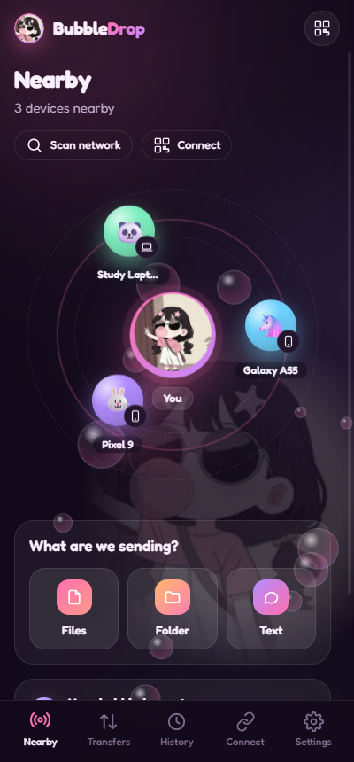
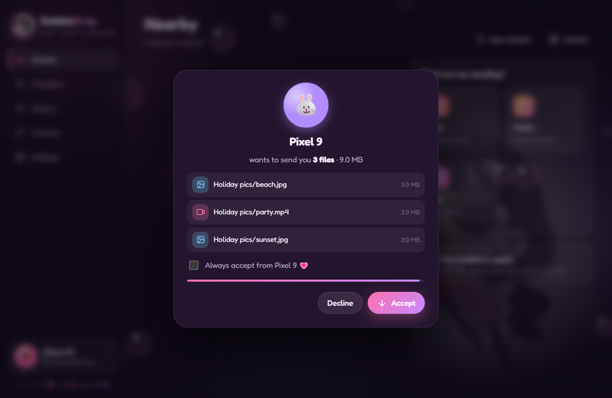

# BubbleDrop 🫧

*made with 💗 by **kitty_no_sushie***

**AirDrop-style file sharing between Windows and Android, with no internet needed.**
A free SHAREit alternative without ads: share files between your PC and phone over Wi-Fi or a phone hotspot.
No internet, no mobile data, no account.

**[⬇ Download the latest release](../../releases/latest)** (Windows installer, portable exe, Android APK)

<p align="center">
  
  
</p>
<p align="center">
  
</p>

## Install

| Device | File (from [Releases](../../releases/latest)) | Notes |
|---|---|---|
| Windows | `BubbleDrop-Setup-<version>.exe` | Recommended. Also adds the Windows Firewall rule so phones can reach your PC. |
| Windows | `BubbleDrop-Portable-<version>.exe` | No install. Click **Allow access** (tick *Public* too) when Windows Firewall asks. |
| Android 10+ | `BubbleDrop-<version>.apk` | Copy it to the phone and open it. Allow "Install unknown apps" for your file manager when asked. |

Windows may show "Windows protected your PC" because the app isn't code-signed: click **More info → Run anyway**.

Once the Windows Package Manager listing is approved you can also install with:

```bash
winget install kitty_no_sushie.BubbleDrop
```

Store listings (winget, IzzyOnDroid, F-Droid) are tracked in [packaging/STORES.md](packaging/STORES.md).

## Connect the devices

1. **Same Wi-Fi:** open BubbleDrop on both. They appear on each other's radar within a few seconds.
2. **No Wi-Fi?** On the phone: **Connect → Start hotspot**. On the PC: **Connect → Join a phone's hotspot** and type the name + password the phone shows. (Other phones can just scan the Wi-Fi QR code with their camera.)
3. **Still not showing?** Tap **Scan network**, scan the PC's QR code from the phone (**Connect → Scan QR code**), or type the IP shown on the other device.

## Send

Pick **Files / Photos / Folder / Apps / Text** (or drag files onto the PC window, or use Android's *Share → Send with BubbleDrop*), then tap a device bubble.
The other device gets an **Accept / Decline** prompt. Tick *Always accept* to trust a device 💗.

## Features

- Auto-discovery (UDP multicast + broadcast), subnet scan, QR code and manual IP fallbacks
- Files, whole folders (structure kept), photos & videos, installed apps (APKs), text & links
- 3 files in parallel, live progress / speed / time left, cancel from either side, retry
- Trusted devices auto-accept; optional "accept everything" mode
- History with open / show-in-folder, search and filters
- **Web Share:** any phone or laptop with a browser can download your selected files or upload to you, protected by a 4-digit PIN. No app needed.
- Android: Local-only hotspot, QR scanner, share-sheet target, keeps receiving in the background, saves to `Download/BubbleDrop`
- Windows: tray icon (keeps receiving when closed), notifications, drag & drop, choose your save folder (default `Downloads\BubbleDrop`)
- Dark bubblegum & light themes, with the mascot and the kitty_no_sushie signature throughout

## Project layout

```
web/       Shared UI (HTML/CSS/JS) used by both apps, plus the Web Share page
desktop/   Windows app: Electron shell + Node engine (core/engine.js)
android/   Android app: Kotlin engine (core/) + WebView shell
assets/    Mascot image + icon generator (python assets/make_icons.py)
PROTOCOL.md  How the apps talk to each other
```

How it works in depth: [Technical report](docs/TECHNICAL_REPORT.md).

## Build it yourself

**Windows** (Node 20+):
```bash
cd desktop
npm ci
node node_modules/electron/install.js
npm start        # run in dev mode
npm test         # engine end-to-end test
npm run dist     # builds dist/BubbleDrop-Setup-*.exe and the portable exe
```

**Android** (JDK 17+, Android SDK 36; Android Studio's bundled JDK works):
```bash
cd android
./gradlew assembleRelease      # app/build/outputs/apk/release/app-release.apk
./gradlew testDebugUnitTest    # engine tests (run desktop/test/interop-peer.js first to also test Android ↔ Windows)
```

The release APK is signed with your local debug key, which is fine for installing on your own phones but not for the Play Store.

## Privacy & security

Everything stays on your local network. Nothing is uploaded anywhere. Transfers are plain HTTP on the LAN
(like most local-share apps), so use it on networks you trust; every incoming transfer needs your OK unless you trusted the sender.

---
© 2026 kitty_no_sushie
